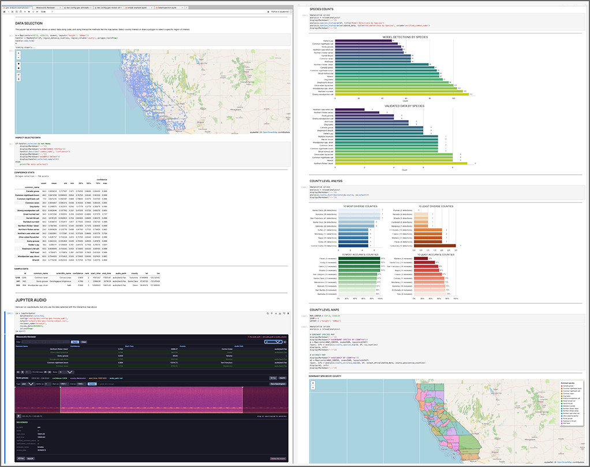

# Jupyter Bioacoustic Demo

Interactive demo notebooks for the [jupyter-bioacoustic](https://github.com/SchmidtDSE/jupyter_bioacoustic) JupyterLab extension.

- **Site**: [schmidtdse.github.io/jupyter_bioacoustic](https://schmidtdse.github.io/jupyter_bioacoustic/)
- **Docs**: [GitHub Wiki](https://github.com/SchmidtDSE/jupyter_bioacoustic/wiki)



## Overview

This repo contains two notebooks demonstrate how to use `BioacousticAnnotator`:

- [**Simple Examples**](simple-example.ipynb):
    - **Annotation**: Assign species labels and mark time/frequency regions in audio clips
    - **Review**: Validate AI model predictions with human expertise
- [**Geo-Analysis**](geo-analysis-example.ipynb): Combine geographic data selection with audio review and downstream analysis

## Quick Start

### Using Pixi (recommended)

[Pixi](https://pixi.sh) manages all dependencies automatically from the `pyproject.toml`:

```bash
git clone https://github.com/SchmidtDSE/jupyter_bioacoustic_demo.git
cd jupyter_bioacoustic_demo
pixi run jba lab
```

This installs `jupyter-bioacoustic`, `ipyleaflet`, `shapely`, `seaborn`, and all other dependencies, then launches JupyterLab with the required `iopub_data_rate_limit` setting.

> Spectrograms are sent as base64 images over Jupyter's IOPub channel, which can exceed the default rate limit. `jba lab` prevents throttling. If running `jupyter lab` directly use `iopub_data_rate_limit` flag (`jupyter lab '--ServerApp.iopub_data_rate_limit=1e10`).

## Demo Notebooks

### Simple Example (`simple-example.ipynb`)

Two workflows in one notebook. Both use project [configuration](https://github.com/SchmidtDSE/jupyter_bioacoustic/wiki/Configuration) files: 

[**Annotation**](annotator_config/projects/simple_annotator.yaml) (`annotator_name/date` are arbitrary kwargs that get passed into the output dataset)

```python
ba = BioacousticAnnotator(
    project='annotator_config/projects/simple_annotator.yaml',
    annotator_name='brookie',
    annotate_date=20260515
)
ba.open()
```

[**Review**](annotator_config/projects/simple_review.yaml) 

```python
ba = BioacousticAnnotator('annotator_config/projects/simple_review.yaml')
ba.open()
```

See the [Configuration wiki](https://github.com/SchmidtDSE/jupyter_bioacoustic/wiki/Configuration) and [Configurable Forms wiki](https://github.com/SchmidtDSE/jupyter_bioacoustic/wiki/Configurable-Forms) for all available parameters.


### Geographic Analysis (`geo-analysis-example.ipynb`)

End-to-end workflow that stays inside the Jupyter ecosystem:

1. Load model predictions and county boundaries
2. Select regions on an interactive map (click counties or draw polygons)
3. Review selected clips with `BioacousticAnnotator`
4. Analyze species distributions and model accuracy
5. Generate county-level choropleth maps


## Documentation

- [Full Documentation (MyST)](https://schmidtdse.github.io/jupyter_bioacoustic/)
- [GitHub Wiki](https://github.com/SchmidtDSE/jupyter_bioacoustic/wiki)
- [API Reference](https://github.com/SchmidtDSE/jupyter_bioacoustic/wiki/API-Reference)
- [Configuration](https://github.com/SchmidtDSE/jupyter_bioacoustic/wiki/Configuration)
- [Configurable Forms](https://github.com/SchmidtDSE/jupyter_bioacoustic/wiki/Configurable-Forms)

## License

BSD 3-Clause. See LICENSE for details.

Developed by the [Eric and Wendy Schmidt Center for Data Science and Environment](https://dse.berkeley.edu) at UC Berkeley.
